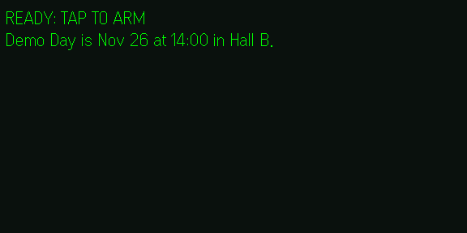
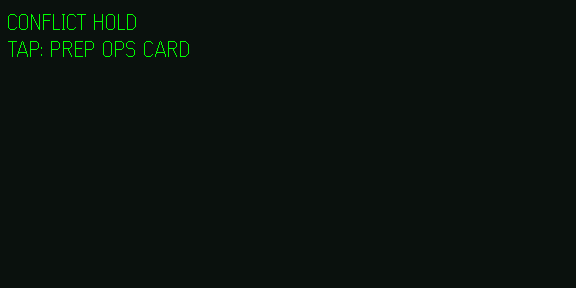
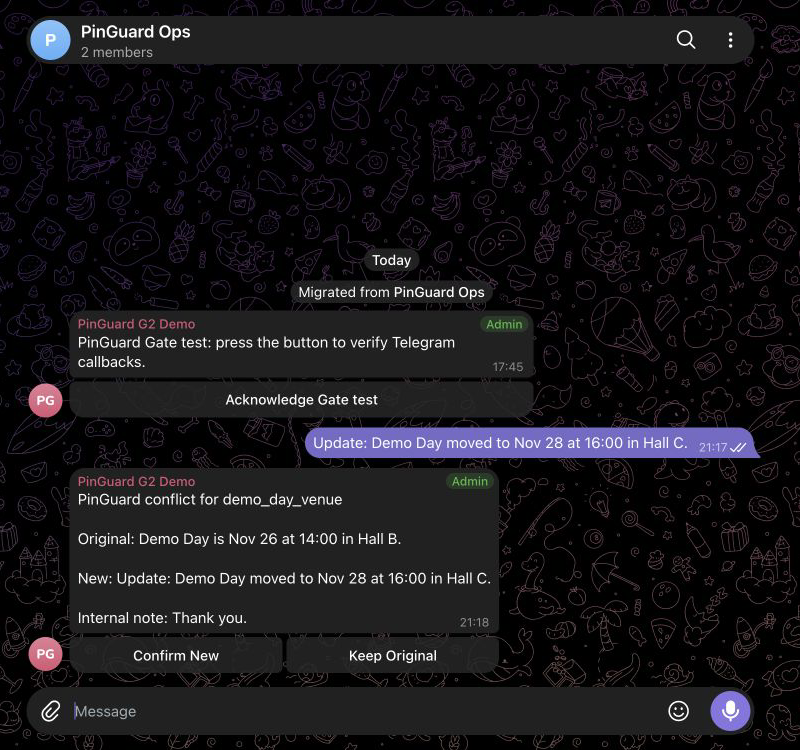
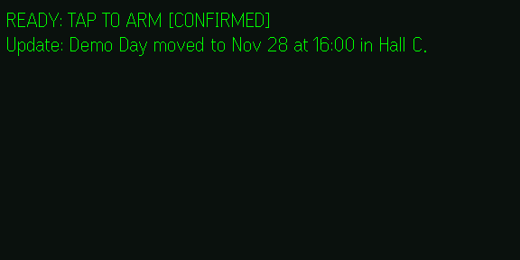
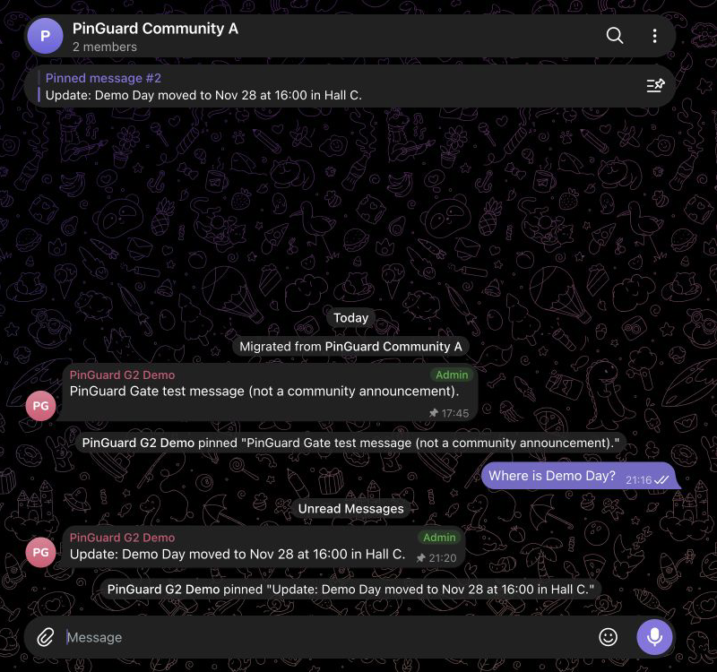
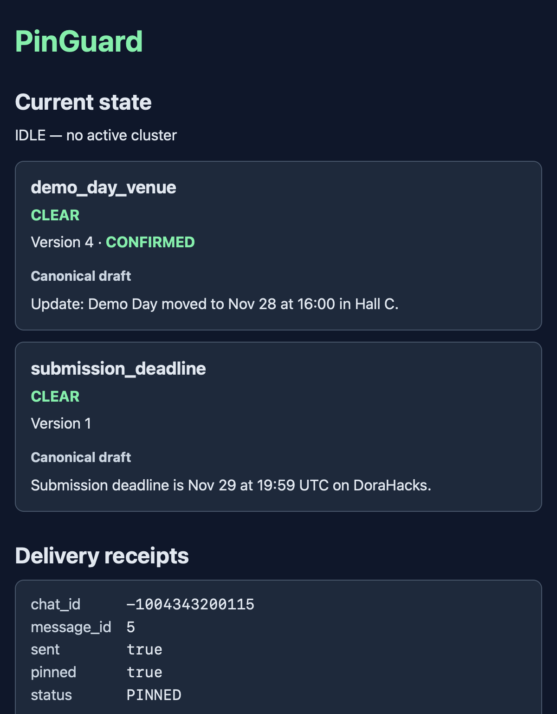

# PinGuard — Conflict-Locked Telegram Broadcast & Pinning for Even G2

**Track 01 (Messaging & News) · Best Telegram Integration** — *Heads Up: Even Realities Hackathon*

- **Demo Video (48.6 s, 1080p30)**: [Watch on YouTube](https://youtu.be/uvEBFYPUSIQ)
- **Packaged Even Hub Build (`.ehpk`)**: [Download `pinguard-v0.1.0.ehpk`](https://github.com/GGGODLIN/even-pinguard/releases/tag/v0.1.0)

Community organizers running multiple Telegram groups during launches, hackathons, or Demo Days face two failures with raw notification feeds on smart glasses: high-volume chatter buries repeated questions, and answering from memory can contradict a newer admin update in an ops chat—broadcasting and pinning stale times or rooms across every community group.

**PinGuard** is a single-process Even Hub TypeScript web app + Node.js/SQLite backend built for Even G2 glasses (`@evenrealities/even_hub_sdk@0.0.16`). Instead of dumping raw unread messages onto the monochrome lens, it clusters repeated questions locally, cross-checks canonical seeded facts against recent admin updates, hard-locks public sends on conflict, and requires an orthogonal two-step glasses gesture (`TAP` to arm → `SWIPE UP` to execute) to post and silently pin verified announcements across affected Telegram groups.

---

## Live End-to-End Flow (Even Hub Simulator 0.9.5 + Real Telegram)

All screenshots and receipts below were captured live on `2026-11-23` running the single-process PinGuard server against `@pinguard_g2_demo_bot`, real Telegram supergroups, and `@evenrealities/evenhub-simulator@0.9.5`.

### 1. Cross-Group Repeated Questions → `READY` Card on Even G2 Lens

When repeated questions hit threshold (`>=3` messages in one group or `>=2` messages across `>=2` groups) for a seeded canonical fact, the G2 lens displays the exact short reply text to be posted (zero scrolling; drafts exceeding the single-screen display budget render `LONG DRAFT -> OPEN PHONE` and refuse arm/send):



### 2. Conflicting Admin Update → Hard-Locked `HOLD_CONFLICT` (Zero `SEND`/`PIN` Cues)

When an authorized admin posts a conflicting date or numeric value newer than the active canonical revision (`Update: Demo Day moved to Nov 28 at 16:00 in Hall C.` vs `Nov 26 at 14:00 in Hall B.`), PinGuard atomically transitions to `HOLD_CONFLICT`:
- Public `POST /api/actions/execute` is hard-locked (`HTTP 409`, zero public `sendMessage` calls).
- The G2 lens strips all `SEND` / `PIN` cues and switches the orthogonal gesture (`TAP → SWIPE UP`) to escalating a structured Inline Keyboard confirmation card to the internal ops group (with optional `<=10 s` G2 mic WAV note transcribed via Groq `whisper-large-v3-turbo`, degrading gracefully if unconfigured, rate-limited, or timed out).



### 3. Ops Inline Keyboard Confirmation (`Confirm New` / `Keep Original`)



### 4. Causal No-Loop Unlock → `READY [CONFIRMED]` on Lens

Clicking **`Confirm New`** (from an authorized admin) creates a canonical revision whose effective timestamp advances to the conflict timestamp, so messages at or before that timestamp cannot re-trigger `HOLD_CONFLICT`. Any prior armed state on the glasses is invalidated on version change, requiring a fresh `TAP → SWIPE UP` on the updated text:



### 5. Multi-Group `sendMessage` + Silent `pinChatMessage` & Verified Receipts

Executing `TAP → SWIPE UP` broadcasts and silently pins (`disable_notification: true`) across every affected community group, clears the G2 lens back to idle, and persists safe per-group delivery receipts (`PINNED`, `PIN_FAILED`, `SEND_FAILED`, `SEND_UNKNOWN` — never auto-retrying `SEND_UNKNOWN` and never exposing `TELEGRAM_BOT_TOKEN` or `GROQ_API_KEY`):

| Action ID | Chat ID | Message ID | Status | Sent | Pinned | Error |
|---|---|---:|---|---|---|---|
| `4d31a1dd-0260-41c9-ba29-76f7058207d6` | `-1004343200115` (Community A) | `5` | `PINNED` | `true` | `true` | `null` |
| `4d31a1dd-0260-41c9-ba29-76f7058207d6` | `-1004463230101` (Community B) | `3` | `PINNED` | `true` | `true` | `null` |





---

## Architecture & Safety Design

- **Zero-LLM Core Pipeline**: Uses `grammy/web` for Telegram Bot API (`getUpdates` long polling with fail-fast on HTTP `409 Conflict`), `minisearch` (BM25+ with ASCII lowercasing + CJK 2-gram tokenizer) for repeated-question clustering, `chrono-node` + numeric extraction for deterministic conflict detection, and Node 24's built-in `node:sqlite` (`DatabaseSync`) as single source of truth (`facts`, `fact_revisions`, `clusters`, `deliveries`).
- **Orthogonal 3-Gesture Safety (`GlassesController`)**:
  - Unarmed `TAP` arms `(cluster_id, fact_version)`; unarmed `SWIPE UP` is a strict no-op.
  - Armed `SWIPE UP` executes the bound version; armed `TAP` or `SWIPE DOWN` disarms cleanly.
  - `DOUBLE_CLICK_EVENT (3)` always routes to `shutDownPageContainer(1)` and never executes a broadcast.
  - State drift (`version` / `lock_state` change), `FOREGROUND_ENTER_EVENT (4)`, or device disconnect immediately disarms local state.
  - All bridge calls run strictly serialized via `await` with debounce; failed `textContainerUpgrade` (`false`) is never cached as rendered.
- **Scoped Internal Voice Note Only**: G2 microphone PCM16 capture (`<=10 s`, 16 kHz mono WAV via `src/voice/wav.ts`) is enabled **strictly** on internal `HOLD_CONFLICT` escalation (`POST /api/actions/escalate` with `Content-Type: audio/wav`). Public `READY` broadcast paths (`POST /api/actions/execute`) accept only `{ clusterId, expectedVersion }` and never activate the microphone or accept text/STT overrides.
- **Strict Secret Redaction**: `src/redaction.ts` scrubs Telegram Bot Tokens and Groq `gsk_*` keys from all API responses, receipts, and error messages.

---

## Bounded Matching & Conflict Rule Set

- **Question matching:** `minisearch` BM25+ matches against canonical facts seeded from [faq-seed.json](/faq-seed.json) and their example questions, using ASCII lowercasing and CJK 2-gram tokenization. Non-text Telegram updates (`!msg.text`) are ignored by message matching.
- **Date conflicts:** `chrono-node` uses the English and Chinese (EN + ZH) casual parsers and compares explicit `year`, `month`, `day`, and `weekday` components. A same-day, time-only edit with no date or numeric unit change does not trigger a date conflict in v1.
- **Numeric conflicts:** The comparator handles integers and decimals with units including `%`, USD (`$`, `US$`, `USD`), TWD (`NT$`, `TWD`, `元`), and capacity (`seat(s)`, `spot(s)`, `place(s)`, `人`, `位`). It also detects positional swaps within a unit, such as `Room A 80 seats, Room B 120 seats` becoming `Room A 120 seats, Room B 80 seats`.

These are bounded matching rules, not general multilingual NLP.

## Quick Start

### Prerequisites
- **Node.js 24+** (`node:sqlite` built-in)
- A Telegram Bot created via `@BotFather` with group privacy disabled (`/setprivacy` → `Disable`), promoted to Administrator with **Pin Messages** in your test community groups and ops group (and read-only admin in `#announce`)
- Optional `GROQ_API_KEY` for `whisper-large-v3-turbo` voice note transcription on `HOLD_CONFLICT` escalation

### Setup & Run
```bash
npm ci
cp .env.example .env
# Fill TELEGRAM_BOT_TOKEN, COMMUNITY_CHAT_IDS, OPS_CHAT_ID, ANNOUNCE_CHAT_ID, ADMIN_USER_IDS in .env

# 1. Verify bot identity & can_pin_messages on every configured group
npm run gate:preflight

# 2. Build the companion + Even Hub glasses frontend
npm run build

# 3. Start the single-process PinGuard server (serves UI + /api/* + Telegram polling)
npm start

# 4. In a second terminal, launch Even Hub Simulator against the single backend origin
npx evenhub-simulator http://127.0.0.1:3456
```

### Verification & `.ehpk` Packaging
```bash
npm run typecheck   # tsc --noEmit (0 errors)
npm test            # Vitest suite
npx evenhub pack app.json ./dist -o pinguard.ehpk --sdk-ver 0.0.16 --json
```

---

## Build-Week Provenance Disclosure

In keeping with hackathon transparency rules:
- **Pre-Nov-23 (`2026-11-19`)**: Problem research, Even Hub SDK `0.0.16` documentation review, specification drafting, and YAGNI scoping were performed before build week opened and kept outside the repository.
- **Build Week (on/after `2026-11-23 08:00 UTC`)**: Repository initialization (`git init`), 100% of source code, automated tests, independent blind contract verification (78 black-box scenarios across 3 seams), live Telegram Bot + Even Hub Simulator E2E verification, and submission assets were created strictly after the official kickoff timestamp.

---

## 5 Concrete Telegram & Even Hub API Feature Requests

Grounded directly in issues encountered while building and live-testing PinGuard:

1. **Even Hub SDK — Background State Persistence API (`setBackgroundState` / `onBackgroundRestore`)**: Even Hub documentation references background restoration, but `@evenrealities/even_hub_sdk@0.0.16` only emits `FOREGROUND_ENTER_EVENT (4)` without built-in state persistence. Shipping real `setBackgroundState` / `onBackgroundRestore` hooks would let lightweight glasses apps avoid full HTTP re-hydration on every resume while still invalidating stale armed states cleanly.
2. **Even Hub SDK — Explicit Non-Zero Event Normalization for Touchpad Click**: Verified live on `evenhub-simulator@0.9.5`: a single click arrives as `{ sysEvent: { eventSource: 1 } }` with `eventType` omitted (`undefined` due to protobuf3 zero-value omission for `CLICK_EVENT = 0`), whereas swipes arrive on `textEvent` with `eventType: 1/2`. Normalizing omitted `CLICK_EVENT` to `0` inside the JS SDK (or assigning non-zero wire values) would eliminate subtle click-vs-empty-envelope bugs across apps.
3. **Even Hub SDK — Text Layout / Overflow Measurement Callback**: Because G2 text containers enforce a 999-byte limit with no scrollbar and `textContainerUpgrade` returns only a boolean, apps cannot tell whether a dynamic message wrapped cleanly within the 576×288 viewport. Returning `{ ok, truncated, lineCount }` (or exposing a pure text-measure helper matching firmware LVGL font metrics) would allow exact fit checks instead of conservative static heuristics.
4. **Telegram Bot API — Pin Enumeration & Pre-Join Context (`getPinnedMessages`)**: Bots cannot read pre-join history or list multiple pinned announcements in a group, forcing organizers to bootstrap canonical facts from [faq-seed.json](/faq-seed.json). Adding a read-only `getPinnedMessages` endpoint for admin bots would allow zero-config canonical fact discovery upon joining an existing community group.
5. **Telegram Bot API — Idempotency Keys & Atomic Silent Pin on `sendMessage`**: Network timeouts during `sendMessage` leave bots in `SEND_UNKNOWN` where retrying risks duplicate group spam, and splitting `sendMessage` + `pinChatMessage` creates partial-failure states (`PIN_FAILED`). Supporting a client-supplied `idempotency_key` and an optional `pin_silently: true` parameter on `sendMessage` would make multi-group organizer broadcasts atomic and retry-safe.

---

## License

[MIT](LICENSE)
