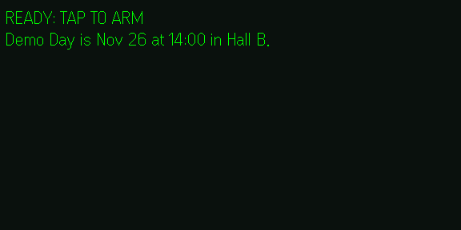
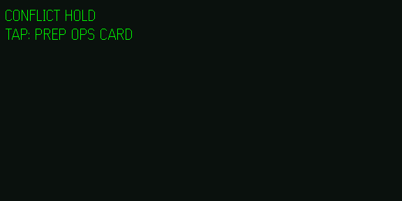
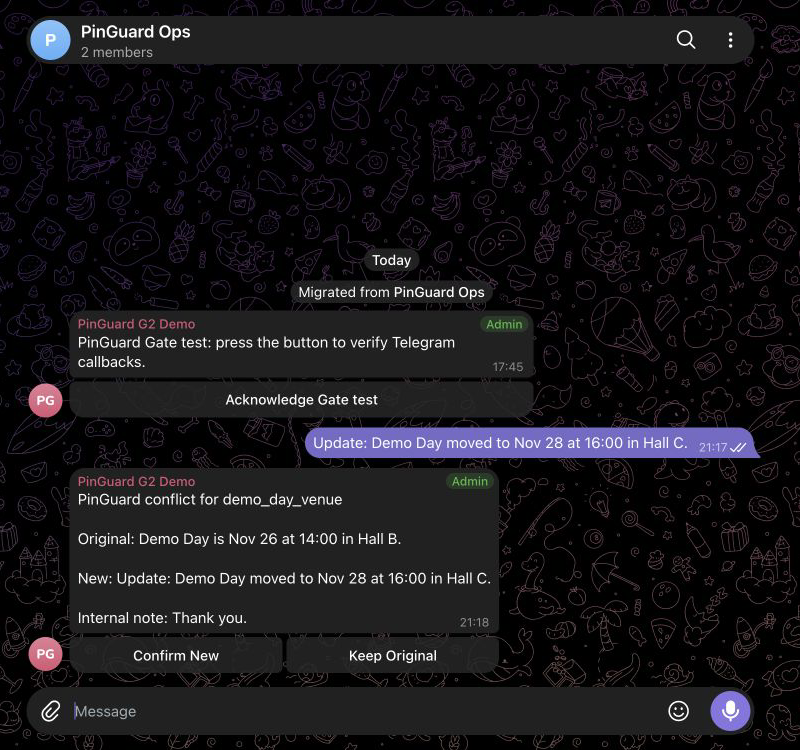
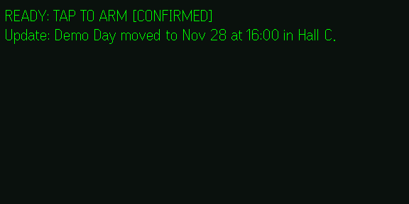
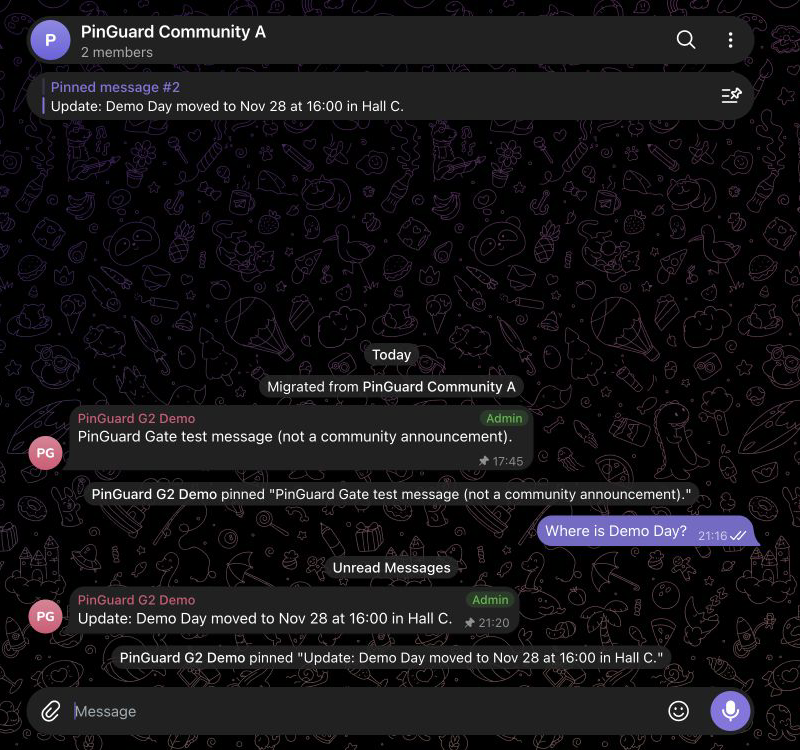
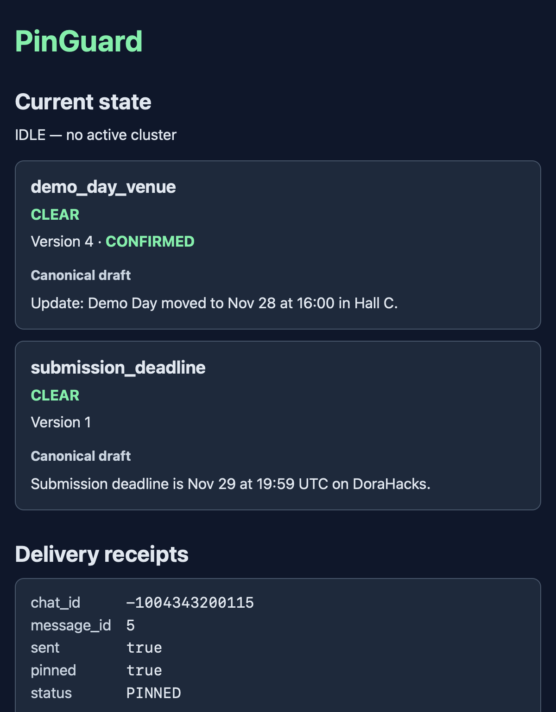

# PinGuard — DoraHacks Submission Draft

- **Event**: Heads Up: Even Realities Hackathon
- **Track**: Track 01 — Messaging & News (+ Best Telegram Integration)
- **Repository**: https://github.com/GGGODLIN/even-pinguard
- **License**: MIT
- **Demo Video**: https://youtu.be/uvEBFYPUSIQ *(48.6 s, 1080p30 — Even Hub Simulator 0.9.5 + real Telegram writes)*
- **Packaged `.ehpk` Build**: https://github.com/GGGODLIN/even-pinguard/releases/tag/v0.1.0

---

## One-Line Summary

Conflict-locked multi-group Telegram broadcast & silent-pin assistant for Even G2 glasses: clusters repeated community questions, hard-locks public sends when an admin update contradicts canonical facts, escalates via Telegram Inline Keyboard (+ optional <=10s Groq voice note), and broadcasts only on orthogonal `TAP -> SWIPE UP` confirmation.

---

## What It Solves

Organizers running multiple Telegram groups during launches or Demo Days face two failure modes on smart-glass notification feeds:
1. High-volume chat buries repeated questions from members across groups.
2. Answering from memory can contradict an update another admin just posted in an ops chat, broadcasting and pinning stale schedules across every community group.

## How PinGuard Works

1. **Deterministic Clustering (`minisearch` BM25+ with CJK 2-gram)**: Collapses repeated questions matching a seeded canonical fact into one glanceable zero-scroll G2 card at `>=3` messages in one group or `>=2` messages across `>=2` groups. Unseeded topics never enter `READY`, and `#announce` ingestion stays strictly read-only.
2. **Conflict Hard-Lock (`chrono-node` + numeric comparator)**: If an authorized admin posts a conflicting date or numeric value newer than the active canonical revision, PinGuard hard-locks public execution (`HTTP 409`, zero public `sendMessage` calls), strips all `SEND`/`PIN` cues from the lens, and switches the glasses gesture to sending a structured Inline Keyboard confirmation card (`Confirm New` / `Keep Original`) to the ops group.
3. **Scoped Internal Voice Note**: Optional `<=10 s` G2 mic capture (16 kHz mono PCM16 → binary WAV → Groq `whisper-large-v3-turbo`) works **only** on internal `HOLD_CONFLICT` ops escalation and degrades gracefully on missing key, HTTP 429, or timeout. Public `READY` broadcast paths expose zero voice/STT parameters.
4. **Orthogonal 3-Gesture Safety (`@evenrealities/even_hub_sdk@0.0.16`)**: Unarmed `SWIPE UP` is a no-op; `TAP` arms `(cluster_id, fact_version)`; armed `SWIPE UP` executes; `TAP`/`SWIPE DOWN` disarms; `DOUBLE_CLICK_EVENT (3)` always routes to `shutDownPageContainer(1)` without sending. Any version drift, `FOREGROUND_ENTER_EVENT (4)`, or disconnect disarms immediately. Oversized drafts render `LONG DRAFT -> OPEN PHONE` and refuse arm/send.
5. **Per-Group Receipts & Secret Redaction**: Records `PINNED`, `PIN_FAILED`, `SEND_FAILED`, and `SEND_UNKNOWN` per group (never auto-retrying `SEND_UNKNOWN`) in SQLite (`node:sqlite`) and renders safe receipts in the companion WebView while scrubbing Telegram Bot Tokens and Groq `gsk_*` keys from all API/log outputs.

---

## Bounded Matching & Conflict Rule Set

- **Question matching:** `minisearch` BM25+ matches against canonical facts seeded from [faq-seed.json](https://github.com/GGGODLIN/even-pinguard/blob/main/faq-seed.json) and their example questions, using ASCII lowercasing and CJK 2-gram tokenization. Non-text Telegram updates (`!msg.text`) are ignored by message matching.
- **Date conflicts:** `chrono-node` uses the English and Chinese (EN + ZH) casual parsers and compares explicit `year`, `month`, `day`, and `weekday` components. A same-day, time-only edit with no date or numeric unit change does not trigger a date conflict in v1.
- **Numeric conflicts:** The comparator handles integers and decimals with units including `%`, USD (`$`, `US$`, `USD`), TWD (`NT$`, `TWD`, `元`), and capacity (`seat(s)`, `spot(s)`, `place(s)`, `人`, `位`). It also detects positional swaps within a unit, such as `Room A 80 seats, Room B 120 seats` becoming `Room A 120 seats, Room B 80 seats`.

These are bounded matching rules, not general multilingual NLP.

---

## Live End-to-End Evidence (2026-11-23)

- **Automated & Blind Contract Verification**: `82/82` Vitest tests passing (`tsc --noEmit` 0 errors, `vite build` clean, `evenhub pack` 38,224-byte `.ehpk` with 0 warnings) + `78/78` independent black-box blind verification scenarios across Seam 1 (17/17 + 40-step patrol), Seam 2 (36/36 + 43-step patrol), and Voice/Companion (25/25), 0 counterexamples.
- **Live Telegram + Even Hub Simulator 0.9.5 Receipts**:
  - Preflight verified `@pinguard_g2_demo_bot` (`can_pin_messages: true`) across Community A (`-1004343200115`), Community B (`-1004463230101`), and Ops (`-1003924897141`).
  - Cross-group questions triggered `READY` on the G2 lens; conflicting admin update locked into `HOLD_CONFLICT` (`HTTP 409` on execute); real simulator `click -> up` escalated Ops Inline Keyboard card (with live Groq STT note); clicking `Confirm New` unlocked `READY [CONFIRMED]` (v4); real simulator `click -> up` delivered & silently pinned `message_id: 5` (`-1004343200115`) and `message_id: 3` (`-1004463230101`), clearing the lens to idle.

---

## Pre-Nov-23 Design Disclosure

Research on Even Hub SDK `0.0.16`, problem framing, and specification scoping took place on `2026-11-19` prior to build week and remained outside the repository. The repository was initialized after `2026-11-23 08:00 UTC`, and 100% of code, tests, live Telegram/simulator verification, and deliverables were produced during build week.

---

## 5 Concrete API Feature Requests

1. **Even Hub SDK `setBackgroundState` / `onBackgroundRestore`**: Implement the documented background state persistence hooks missing in `0.0.16` so glasses apps do not need full HTTP re-hydration on every `FOREGROUND_ENTER_EVENT`.
2. **Even Hub SDK `CLICK_EVENT` Protobuf Zero-Value Normalization**: Normalize omitted `eventType` (`undefined` on `sysEvent` for protobuf3 enum `0`) to explicit `CLICK_EVENT = 0` inside the JS SDK so apps cannot confuse empty envelopes with taps.
3. **Even Hub SDK Text Overflow / Line-Count Feedback**: Return `{ ok, truncated, lineCount }` from `textContainerUpgrade` (or expose LVGL text measurement) so apps can enforce exact zero-scroll safety instead of conservative character heuristics.
4. **Telegram Bot API `getPinnedMessages`**: Expose read-only enumeration of currently pinned group messages for admin bots to eliminate manual FAQ seeding for existing groups.
5. **Telegram Bot API Idempotent `sendMessage` with Atomic `pin_silently`**: Add client-supplied `idempotency_key` and optional `pin_silently: true` on `sendMessage` to eliminate `SEND_UNKNOWN` retry hazards and `PIN_FAILED` split states.
